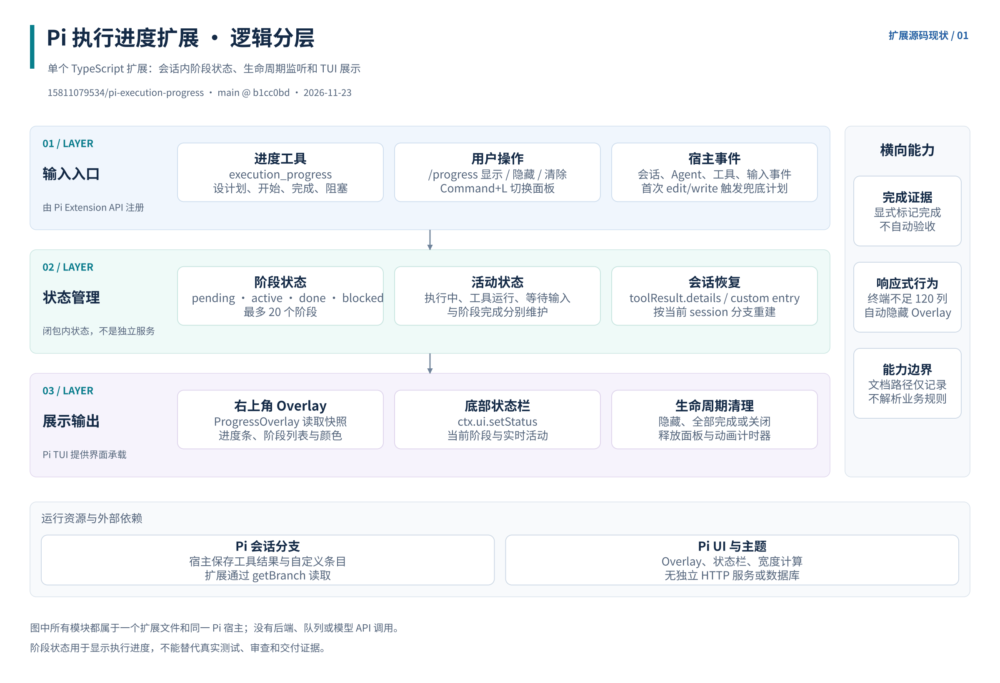

# pi-execution-progress

可复用的 Pi 执行进度 Package：在 Pi TUI 右上角显示固定执行阶段，并在底部状态栏同步当前状态。

仓库：https://github.com/15811079534/pi-execution-progress

npm：https://www.npmjs.com/package/pi-execution-progress

## 能力

- `execution_progress` 工具：创建和更新执行阶段；
- `/progress` 命令：显示、隐藏或清除面板；
- `Command+L`：显示/隐藏面板；
- Overlay 固定在终端右上角；
- 状态写入当前 Pi session 分支，支持恢复；
- 首次实际 `edit`/`write` 前提供最小 fallback plan；
- 窄终端自动隐藏 Overlay，避免挤压编辑器。

本 Package 只提供通用执行状态能力，不内置任何项目的风险门禁、测试命令、closeout 流程或业务规则。

## 安装

用户级安装，供所有项目使用：

```bash
pi install /absolute/path/to/pi-execution-progress
```

从 GitHub Tag 安装：

```bash
pi install git:github.com/15811079534/pi-execution-progress@v0.1.0
```

从 npm 安装：

```bash
pi install npm:pi-execution-progress@0.1.0
```

查看已安装 Package：

```bash
pi list
```

仅当前运行临时试用：

```bash
pi -e /absolute/path/to/pi-execution-progress
```

安装 Package 后，不要同时保留同一扩展的项目级副本，否则可能重复注册工具、命令或快捷键。

## 使用

显式创建计划：

```json
{
  "action": "set_plan",
  "title": "实现任务",
  "phases": [
    "理解目标和现有实现",
    "完成代码修改",
    "执行定向验证",
    "整理测试与交付证据"
  ]
}
```

更新阶段：

```json
{"action":"start","phase":1}
{"action":"complete","phase":1}
{"action":"block","phase":2,"reason":"等待外部依赖"}
{"action":"resume","phase":2}
```

用户命令：

```text
/progress          显示面板
/progress show     显示面板
/progress hide     隐藏面板
/progress clear    清除当前进度
```

## 设计边界

- 面板是执行状态视图，不替代测试、QA 或发布证据；
- 阶段完成必须由 Agent 根据实际证据更新，不能仅依据某条命令退出成功自动判定；
- 状态属于当前 Pi session 分支，不是外部任务数据库；
- Package 不解析 `sourceDoc`，该字段只作为会话元数据保存；
- 项目专属规范继续由项目级 `AGENTS.md`、Skill 或文档提供。

## 开发

```bash
npm test
```

当前测试覆盖 Overlay 布局、快捷键、状态恢复和生命周期契约。真实终端视觉检查仍需在目标终端中执行。

## 架构导航

[扩展架构、事件和会话状态](docs/architecture.md) · [可编辑 draw.io 源图](docs/diagrams/pi-progress-architecture.drawio)


