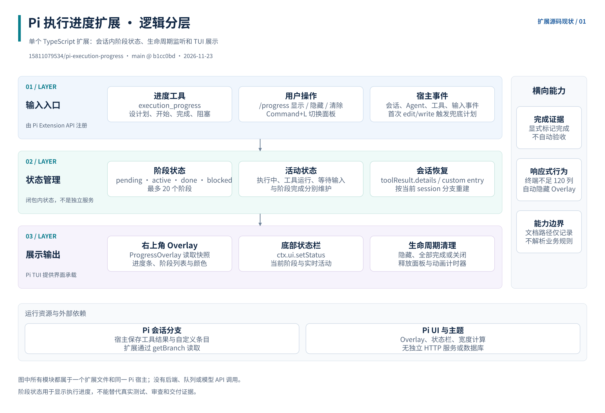

# Pi 执行进度扩展架构

`pi-execution-progress` 是由 Pi 加载的单文件 TypeScript 扩展。它把计划阶段、当前活动与可恢复的会话状态显示在 TUI 的右上角和底部状态栏。本仓不包含独立服务端、数据库或模型调用；下图按代码职责拆分同一扩展内部模块。

核对日期：2026-11-23。分支：`main`。源码基线：[`b1cc0bdac449`](https://github.com/15811079534/pi-execution-progress/commit/b1cc0bdac449e4a1e5823409d6f1e81c1c110e6e)。

## 逻辑分层

`package.json` 的 `pi.extensions` 指向 `extensions/execution-progress.ts`。默认导出的注册函数调用 Pi Extension API，注册 `execution_progress` 工具、`/progress` 命令、Command+L 快捷键与宿主事件监听器。阶段、活动、Overlay 引用和计时器都保存在注册函数的闭包中。

进度工具用 TypeBox 校验输入，可创建最多 20 个阶段；`start` / `resume` 把指定阶段改为 active，并把此前 active 阶段恢复为 pending，`complete` 标记完成，`block` 保存阻塞原因，`clear` 清除计划。活动状态则根据 Agent、工具和等待输入事件更新：一次工具成功结束只会把活动切回执行中，不会把阶段标记为完成。

## 状态与事件的连接

| 触发 | 实际处理 |
| --- | --- |
| `execution_progress` 调用 | 修改阶段状态，在工具结果 `details.state` 返回快照 |
| `/progress clear`、自动兜底计划 | 使用 `pi.appendEntry` 写入 `execution-progress-state` 自定义条目 |
| session start / tree | 遍历当前分支的工具结果和自定义条目，恢复最后有效状态 |
| session compact | 重读分支状态，并在下次 Agent 启动前注入未完成阶段摘要 |
| before agent start | 用提示词启发式识别实施任务，提示 Agent 建立并维护计划 |
| 首次 edit / write | 没有未完成计划时建立四阶段兜底计划；其他工具名不触发此判定 |
| tool / agent / prompt 事件 | 更新活动和显示；不会自动验证项目结果或完成阶段 |
| session shutdown | 停止动画，清理状态栏、Overlay 与句柄 |

会话持久化由 Pi 宿主承担：扩展使用 `getBranch()` 读取当前分支，识别自己的工具结果和自定义条目，不直接写外部数据库或会话文件。`sourceDoc` 仅存为元数据，扩展不打开、解析或核实它指向的文档。

## TUI 与清理边界

`ProgressOverlay` 在渲染时读取最新快照，使用宿主主题、可见宽度和截断函数组织阶段列表。面板以 nonCapturing Overlay 固定在右上角，标称宽度 58 列、最小宽度 48 列；终端不足 120 列时不显示 Overlay。底部状态栏独立显示尚未完成的当前阶段与活动。

只有面板显示、终端尺寸允许、有未完成计划且摘要处于执行中时，160 毫秒动画计时器才运转。隐藏、终端变窄、全部阶段完成或会话退出会停止动画或释放 Overlay。实际视觉效果依赖 Pi 宿主与目标终端，本次没有启动真实 Pi TUI 验收。

## 源码依据与维护

| 关注点 | 直接依据 |
| --- | --- |
| 包入口与宿主依赖 | [package.json](../package.json) |
| 输入、状态、恢复与 UI | [execution-progress.ts](../extensions/execution-progress.ts) 中的 `ProgressParams`、`stateFromBranch`、`ProgressOverlay` 与默认注册函数 |
| 使用契约与能力边界 | [README.md](../README.md) |
| 自动检查 | [test workflow](../.github/workflows/test.yml)：Node 20 / 22 执行测试与 npm pack dry-run，没有发布步骤 |

本页只使用本公开仓库证据。面板不会自动审查代码、执行测试或证明阶段完成，项目规则继续由项目自身文档提供。文档任务没有更改扩展行为，也未重复运行应用测试。

编辑源为 [`pi-progress-architecture.drawio`](diagrams/pi-progress-architecture.drawio)。本扩展规模适合一张内部逻辑图，状态连接由上表说明；修改事件订阅、状态快照或 TUI 生命周期时同步维护本页及 PNG。当前预览由本地 XML/SVG 渲染链生成并做图形检查；本环境未完成原生 draw.io 编辑器导出验证。
